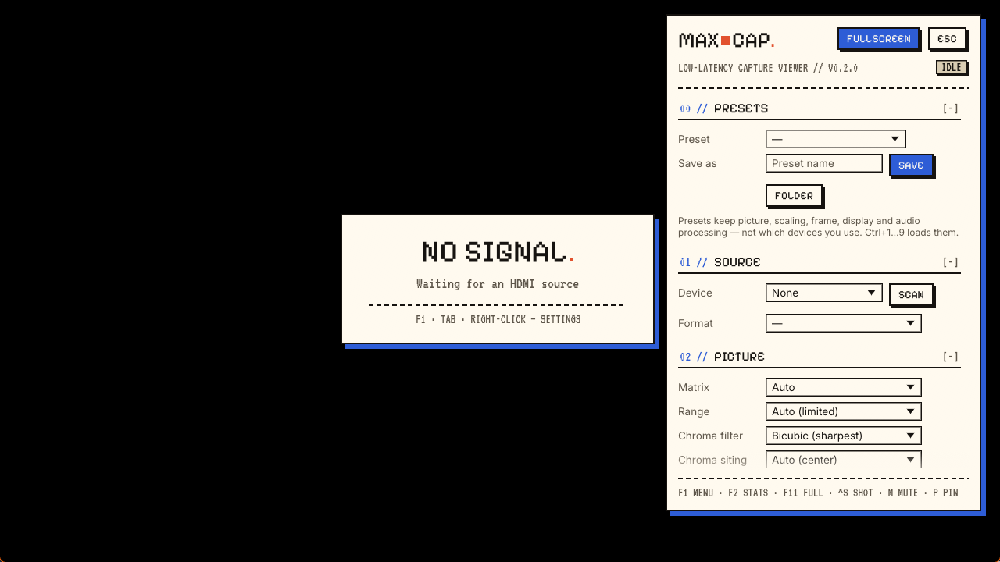

# capview

A clean, low-latency viewer for USB HDMI capture cards on Windows: uncompressed capture
straight into the GPU, high-quality scaling, and a pixel-editorial UI.



## Highlights

- **Low latency:** ~1–2 ms from frame arrival to present on a 1080p60 card.
  - Media Foundation async reader in `MF_LOW_LATENCY` mode.
  - Frames are uploaded to the GPU from the capture thread, with no CPU hand-off queue.
  - DirectX 12 flip-model swapchain, 1 frame in flight, optional tearing (Immediate).
  - The window redraws only when a new frame arrives.
- **Picture quality:**
  - Uses the uncompressed format (YUY2 / NV12 / P010) whenever the card offers it.
  - Colour conversion on the GPU with the right BT.601 / 709 / 2020 matrix and full/limited range, auto-detected from the device (overridable).
  - Correct chroma siting and bicubic chroma upsampling.
  - Scaling: Lanczos 2/3, Catmull-Rom, Mitchell, sharp-bilinear, nearest. Anti-ringing, optional linear-light scaling, contrast-adaptive sharpening.
  - 10-bit output with dithering.
- **Geometry:** fit / fill / stretch / integer / 1:1 sizing, aspect override, zoom, crop, rotate, flip.
- **Presets:** save your setup by name, switch with Ctrl+1–9.
  - A preset stores picture, scaling, frame/background, display and audio processing, but never which devices you use.
- **Backgrounds and frames:**
  - Background: an image behind the video (cover / contain / stretch / center / tile, plus dim) or a solid colour.
  - Frame: built-in styles (outline, pixel card, hard shadow), or your own PNG scaled 9-slice, so one frame fits every size and aspect mode.
  - The video shrinks to make room, so the frame is never clipped.
- **Audio passthrough:** the card's audio input is matched automatically. Drift-corrected resampling keeps a fixed delay, which you can set.
  - Clean-up for noisy cards: DC blocker, spectral hiss reduction (learns the card's noise while it's quiet) and a noise gate.
  - Includes a fix for MS2109 cards, which report "96 kHz mono" but actually send 48 kHz stereo.
- **Robust:**
  - Recovers from unplug/replug and stream stalls.
  - Can't hang on a wedged driver.
  - Warns when a mode delivers fewer frames than it advertises.
- **Stats HUD:** fps, pacing jitter, drops, frame→present latency, audio buffer, frame-time graph.
- **Screenshots** at source resolution (PNG).

## Install

Requires Windows 10/11 and a DirectX 12 GPU.

```bash
git clone https://github.com/noahsmaximum/capview
cd capview
cargo build --release
target/release/capview.exe
```

It picks your capture card automatically. Webcams and virtual cameras are skipped.

## Controls

| Key | Action |
| --- | --- |
| F1 / Tab / right-click | Settings |
| F2 | Stats HUD |
| F11 / Alt+Enter / double-click | Fullscreen |
| Ctrl+S / F12 | Screenshot |
| M | Mute |
| P | Pin on top |
| I | Toggle integer scaling |
| R | Reset picture |
| Ctrl+1 … 9 | Load preset 1–9 |
| Esc | Exit fullscreen / close settings |

Settings are saved to `%APPDATA%\capview\settings.json` one second after each change. Presets live in `presets\` and imported images in `images\` in the same folder.

## Tips

- **Lowest latency:** Immediate present + 1 frame in flight + fullscreen. In fullscreen the frame can skip the desktop compositor.
- **Use a good USB 3 port.** A flaky port shows up as stalls, or the card dropping off the bus ("Device Descriptor Request Failed").
- **"4K" on cheap cards usually means 4K input.** MS2130-class cards scale it to 1080p before USB, so feeding them 1080p gives the sharpest picture.
- **USB 2.0 cards (MS2109)** only reach 1080p via MJPEG, at ~30 fps. Their 720p60 mode delivers a true 60.

## How it works

```
capture thread (MMCSS "Capture")            render thread (winit)
  IMFSourceReader (async, low latency)        convert.wgsl  YUV→RGB @ source res (Rgba16F)
  → queue.write_texture(planes) ───────────▶  sharpen.wgsl  optional CAS
  → wake event loop                           scale.wgsl    resample + letterbox → swapchain
                                              egui overlay  → present
```

`src/capture.rs` (Media Foundation), `src/render.rs` + `src/shaders/` (wgpu), `src/audio.rs`
(cpal/WASAPI passthrough), `src/ui.rs` + `src/theme.rs` (egui UI).

### Headless test hooks

| Env var | Effect |
| --- | --- |
| `CAPVIEW_SMOKE=<secs>` | Log stats every second, screenshot at 3 s, exit. Never writes settings. |
| `CAPVIEW_SMOKE_UI=1` \| `panel` | Open the settings panel (+ stats HUD unless `panel`). |
| `CAPVIEW_DEVICE=<substring>` | Force a device by name. |
| `CAPVIEW_FORMAT=<key>` | Force a mode, e.g. `YUY2 1920x1080@60/1`. |
| `CAPVIEW_SHOT_PATH=<file>` | Screenshot destination. |
| `CAPVIEW_NO_SOURCE=1` | Open no device (UI screenshots). |
| `CAPVIEW_CONFIG_DIR=<folder>` | Use a separate settings/presets/images folder. |

## Credits

- UI style inspired by the [OVERWORLD design system](https://uiverse.io/ui-kits/overworld) on Uiverse.
- Fonts: [Pixelify Sans](https://fonts.google.com/specimen/Pixelify+Sans), [Inter](https://fonts.google.com/specimen/Inter) and [VT323](https://fonts.google.com/specimen/VT323), all under the SIL Open Font License (see `assets/fonts/`).

## License

MIT (fonts excluded; they are OFL).
